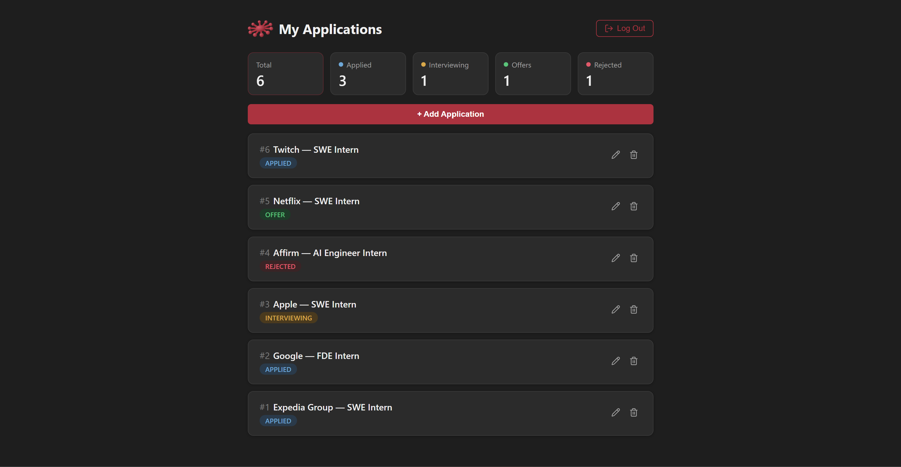
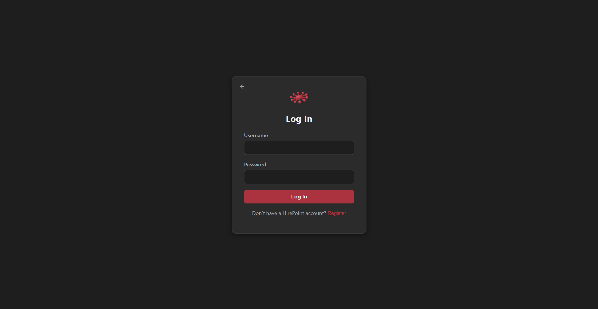
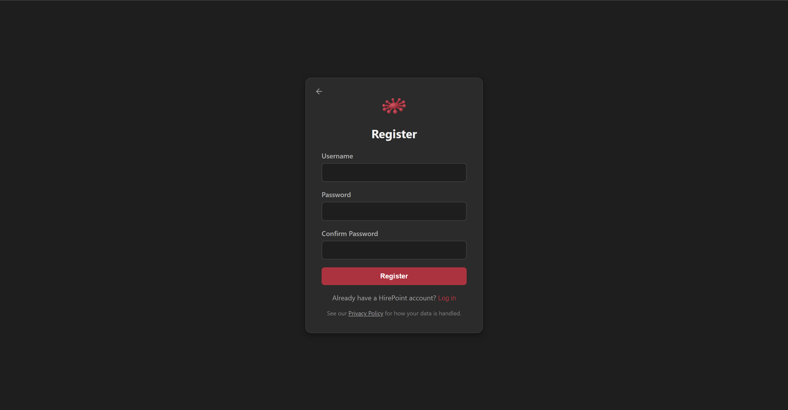
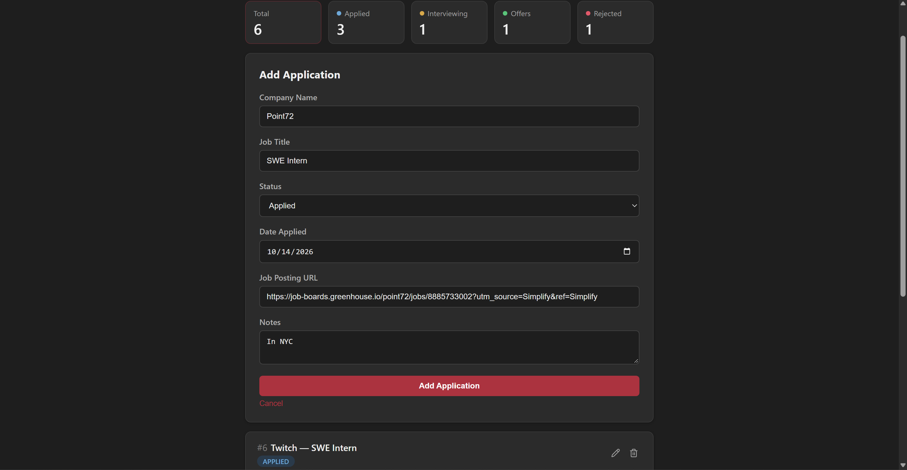

# HirePoint

A full-stack job application tracker — register, log in, and manage your job search with a clean, dark-themed dashboard. Built end-to-end from a single Spring Boot endpoint through to a fully deployed, HTTPS-secured production app on AWS.

**Live app:** [https://hirepoint.dev](https://hirepoint.dev)

---

## Screenshots

<p align="center">
  <br>
  <em>Dashboard — track every application's status at a glance</em>
</p>

<p align="center">
  
  <br>
  <em>Login and registration</em>
</p>

<p align="center">
  <br>
  <em>Adding a new application</em>
</p>

---

## Features

- **Authentication** — register/login with JWT-based auth, passwords hashed with BCrypt
- **Full CRUD** — create, view, edit, and delete job applications, each scoped to the logged-in user with ownership checks on every write
- **Application tracking** — company name, job title, status (Applied / Interviewing / Offer / Rejected), date applied, job posting URL, and notes
- **Server-side validation** — required fields enforced with Jakarta Bean Validation, in addition to client-side checks
- **Logging** — structured request/event logging (SLF4J) for auth and application actions
- **Landing page** — introduces the app to logged-out visitors with a live-styled dashboard preview and a "how it works" walkthrough
- **Dark UI** — custom charcoal/red theme, color-coded status badges, inline editing, collapsible add-application form

## Tech Stack

**Backend**
- Java 21, Spring Boot 4
- Spring Web, Spring Data JPA (Hibernate), Spring Security
- JWT authentication (jjwt)
- PostgreSQL
- Jakarta Bean Validation

**Frontend**
- React + TypeScript (Vite)
- Plain CSS (no framework) — custom dark theme
- lucide-react icons

**Infrastructure**
- **Docker** — multi-stage build for the backend; Docker Compose for both local dev and production
- **AWS Lightsail** — single Ubuntu server running the backend, database, and reverse proxy
- **Caddy** — reverse proxy with automatic HTTPS (Let's Encrypt certificates, auto-renewed)
- **PostgreSQL 18** — runs in a container on the same server, private to the Docker network
- **AWS S3** — static hosting for the built React app
- **AWS CloudFront + ACM** — CDN and HTTPS for the frontend
- **Cloudflare** — domain registration and DNS for `hirepoint.dev`

## Architecture

```
Browser
  │
  ├── https://hirepoint.dev  ──────────▶  CloudFront  ──▶  S3 (React static build)
  │
  └── https://api.hirepoint.dev  ──────▶  Lightsail server (Docker Compose)
                                              Caddy :443  ──▶  Spring Boot :8080  ──▶  PostgreSQL :5432
```

- The frontend is a static React build served via CloudFront, giving HTTPS and CDN caching in front of a private S3 bucket.
- The backend, database, and Caddy run as three containers on one Lightsail instance, defined in `docker-compose.prod.yml`.
- Only Caddy is reachable from the internet (ports 80/443). Spring Boot and PostgreSQL have no published ports — they talk to each other over Docker's private network, so the database is never exposed publicly.
- Caddy terminates HTTPS and obtains/renews its certificate from Let's Encrypt automatically; plain HTTP is redirected to HTTPS.
- Containers restart automatically on crash or reboot (`restart: unless-stopped`), and the server is backed up with daily Lightsail snapshots.
- CORS is locked down to the production frontend origin.

## Deployment History

HirePoint was first deployed on a managed AWS stack: the backend on **ECS Fargate** behind an **Application Load Balancer**, with **RDS** for PostgreSQL and **ACM** certificates. That setup taught me how the pieces of a production cloud deployment fit together, but at this app's traffic it cost around $60/month — mostly the always-on load balancer, Fargate task, and database.

I migrated the backend to a single **Lightsail** instance running the same Docker image with Docker Compose, adding **Caddy** to replace the load balancer and ACM for HTTPS. This brought the backend down to roughly $12/month. The migration was done with zero data loss: the database was exported from RDS with `pg_dump`, restored into the new PostgreSQL container, verified, and DNS was only switched in Cloudflare once the new server was serving correctly, with the old stack kept running as a fallback.

**Trade-offs:** the managed setup gave automatic database backups, horizontal scaling, and no server to maintain. The single-server setup gives up scaling and redundancy and means handling OS updates and backups myself — a reasonable trade for a portfolio-scale app.

## Running Locally

**Backend** (requires Docker):

```bash
git clone https://github.com/Beglii/hirepoint.git
cd hirepoint
cp .env.example .env   # fill in your own DB password and JWT secret
docker compose up --build
```

This starts the Spring Boot API (`localhost:8080`) and a PostgreSQL container together.

**Frontend:**

```bash
cd hirepoint-frontend
npm install
npm run dev
```

Runs the React app at `localhost:5173`. Note: `API_BASE_URL` in `hirepoint-frontend/src/api.ts` points at the production API, so change it to `http://localhost:8080/api` to develop against the local backend.

## Deploying

**Backend** — on the Lightsail server:

```bash
cd ~/hirepoint
git pull
docker compose -f docker-compose.prod.yml up -d --build
```

The server keeps its own `.env` (database password and JWT secret), which is never committed.

**Frontend:**

```bash
cd hirepoint-frontend
npm run build
```

Then upload the contents of `dist/` to the S3 bucket and create a CloudFront invalidation for `/*` so the CDN serves the new files.

## API Overview

| Method | Endpoint | Auth required | Description |
|---|---|---|---|
| POST | `/api/auth/register` | No | Create a new account |
| POST | `/api/auth/login` | No | Log in, returns a JWT |
| GET | `/api/applications` | Yes | List the current user's applications |
| POST | `/api/applications` | Yes | Create a new application |
| PUT | `/api/applications/{id}` | Yes | Update an application (owner only) |
| DELETE | `/api/applications/{id}` | Yes | Delete an application (owner only) |
| GET | `/health` | No | Health check |

## About This Project

HirePoint was built as a learning project to go deep on the full stack — not just writing CRUD endpoints, but understanding *why* each piece exists: dependency injection, JWT auth from first principles, containerization, and a real cloud deployment with a custom domain and SSL, all built and debugged from scratch — and then re-architected to cut hosting costs once the first version was live.

---

Built by [Begli Rejepov](https://linkedin.com/in/beglirejepov) — [GitHub](https://github.com/Beglii)
